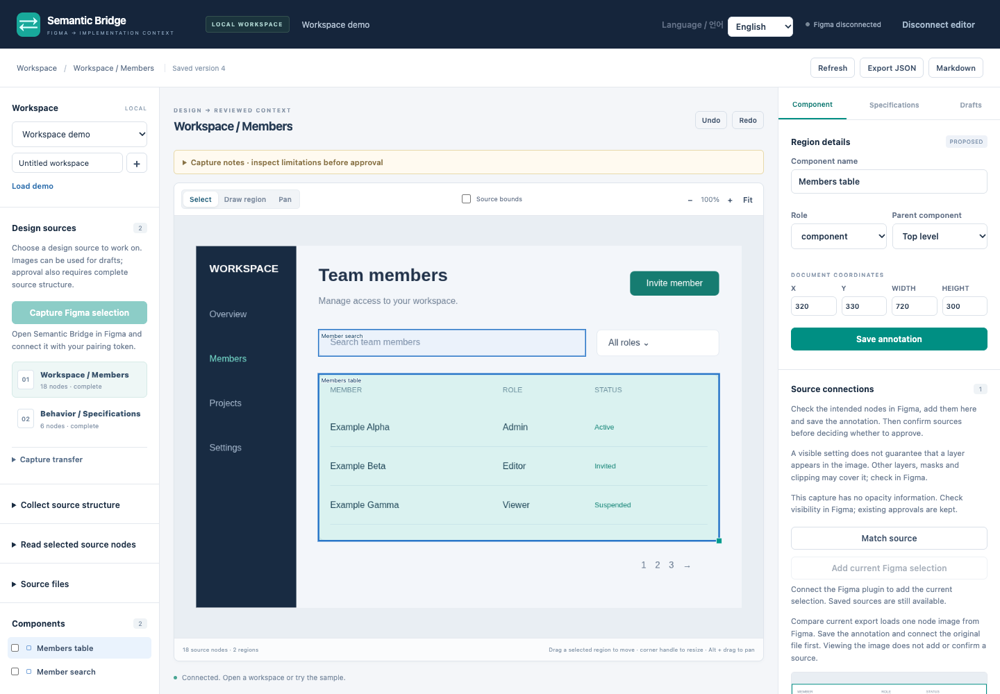

# Figma Semantic Bridge 0.2.0 Alpha

[한국어](README.md) · [Install](docs/alpha-installation.en.md) · [User guide](docs/user-guide.en.md) · [Upgrade](docs/upgrade-guide.md)

**Turn a Figma design into implementation context that people have reviewed.**

Choose a source, mark meaningful components, connect their exact Figma nodes and
specification text, then give a coding agent the approved result through MCP.
Figma Semantic Bridge runs locally and keeps this interpretation separate from
the original design. It does not generate application code or infer product intent
as fact.

## Start here

1. Install the **0.2.0 alpha app** from [Releases](https://github.com/neocjmix/figma-semantic-bridge/releases).
   The Apple Silicon app includes its runtime, local service, editor, MCP server
   and prebuilt Figma plugin. No Node.js installation is needed.
2. Open the app, choose **Bridge → Reveal Figma Plugin**, and import its
   `manifest.json` in Figma Desktop. Use **Bridge → Copy Pairing Token** to connect
   the plugin. The app's own editor connects automatically.
3. Open a workspace, select a permitted Frame in Figma, and choose
   **Capture Figma selection**. Choose whether to acquire an image, structure or both.
4. Save a region, review its source nodes, confirm them when required, then approve
   its meaning. Share through **Export JSON**, **Markdown** or MCP.

[Detailed installation and MCP setup](docs/alpha-installation.en.md) covers
checksums, Figma access, macOS prompts and connection checks. Already using an
older version? [Update the app and plugin together](docs/upgrade-guide.md).
The 0.1.1 downloads do not contain the 0.2.0 workflow or transport changes.

## Choose how much source to read

| Your next task | Use |
| --- | --- |
| Review a small screen and its source nodes | Acquire image and structure, then save the complete capture |
| Sketch component boundaries before reading a large structure | Acquire the image only and use it as a visual draft; attach a complete matching collection before approval |
| Collect a larger selected subtree | Collect and save structure in batches, then add it to the editor or attach it to a matching image |
| Inspect known IDs or discover one parent's children | Selective source inspection; collect only the chosen branch when needed |
| Work without a live Figma connection | Load the demo or import a permitted source file, then review the cached observations |

[Acquisition guide](docs/acquisition-workflow.en.md) explains each path, limits,
pause/resume and incomplete results. Reading one branch does not establish what
exists in its unvisited siblings.

## Review before sharing

- **Source confirmation** records the exact saved node set you reviewed.
- **Annotation approval** records your judgment about a component's meaning,
  boundary, role and parent. Geometry alone cannot make that judgment.
- **Specifications** preserve selected original TEXT and connect it to components.
- **Approved export and MCP** expose reviewed implementation context. Raw source
  transfer is separate and never carries approvals into the receiving workspace.

The [user guide](docs/user-guide.en.md) walks through overlapping layers, current
node previews, exact text and the final coding-agent handoff. The manual workflow
needs no model provider. Optional AI output stays a proposal for human review.

## Connect a coding agent

Keep the app running and choose **Bridge → Copy MCP Configuration**. Add that
configuration to your MCP client without replacing its other settings. It uses
the app's bundled executable and local credentials; do not paste a pairing token
into the configuration.

Verify an actual `list_projects` call, then read `get_approved_context`,
`list_components` or `get_component` for a reviewed workspace. Cached reads do
not require Figma. Live source reads require the connected plugin. MCP can submit
proposals but has no approval tool.

## Alpha boundaries

The app targets **Apple Silicon, macOS 13 or later**. macOS 26.6.2 has been exercised;
macOS 13 execution, Developer ID notarization and Figma Community distribution
are not established. The plugin is imported locally in Figma Desktop. Effective
Dev-only access to another owner's view-only file remains a separate permission
check; an owned-file test does not prove it.

Bounded synthetic workflows have run in actual Figma. A full real-world
106,000-node capture, universal large-file performance and an independent human
productivity study are not claimed. Incomplete source reads cannot be approved
as complete. The app reads design content; **Show in Figma** explicitly changes
selection and viewport, not design properties.

Local app/MCP connections verify a private certificate; plugin messages are
mutually authenticated and encrypted. Saved source text, images and backups are
not encrypted at rest. Use only files you are permitted to inspect and share;
external model transfer requires separate authorization.

## Documentation and development

[Installation](docs/alpha-installation.en.md) · [User guide](docs/user-guide.en.md)
· [Acquisition](docs/acquisition-workflow.en.md) · [Upgrade and backup](docs/upgrade-guide.md)
· [Developer quickstart](docs/product-quickstart.md) · [Architecture](docs/architecture.md)
· [Validation boundaries](docs/product-validation.md) · [Release readiness](docs/release-readiness.md)

Project code and documentation use the [MIT license](LICENSE). External Figma
designs retain their owners' rights. Packaged third-party notices cover the
included runtime and dependencies.
