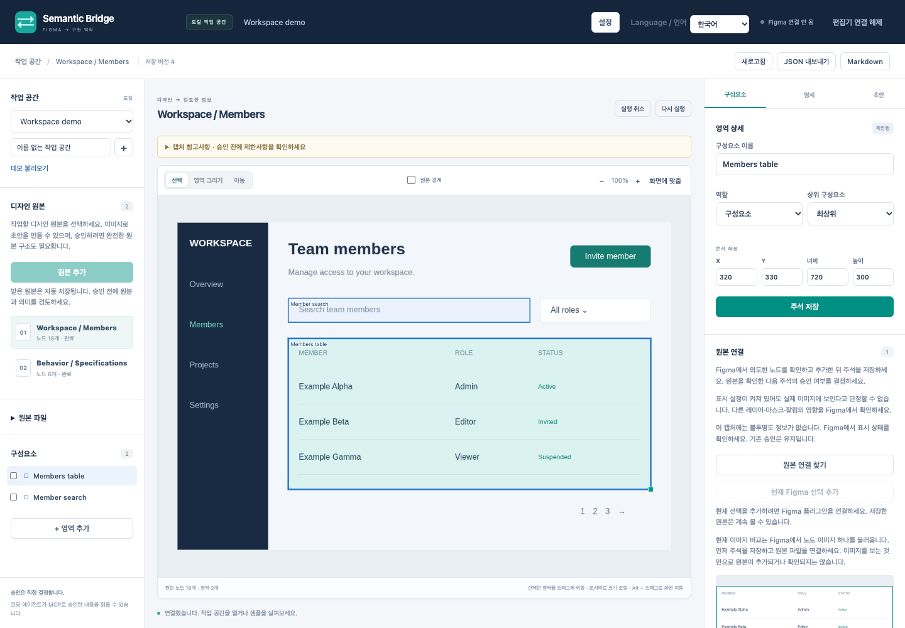

# Figma Semantic Bridge 0.3.0 Alpha

[English](README.en.md) · [설치](docs/alpha-installation.md) · [사용 가이드](docs/user-guide.ko.md) · [업데이트](docs/upgrade-guide.md)

**Figma 디자인에 사람이 검토한 의미를 더해 코딩 에이전트에 전달하는 로컬 앱입니다.**

필요한 원본을 가져오고, 구성요소의 영역을 표시한 뒤 정확한 Figma 노드와 명세
원문을 연결합니다. 사람이 승인한 결과는 MCP로 전달합니다. 원본 디자인과 별도의
해석을 저장하며, 애플리케이션 코드를 생성하거나 불명확한 의도를 사실로 단정하지 않습니다.

## 시작하기

1. [Releases](https://github.com/neocjmix/figma-semantic-bridge/releases)에서 **0.3.0 알파 앱**을 설치합니다.
   Apple Silicon 앱에 실행 환경, 로컬 서비스, 편집기, MCP 서버와 미리 빌드된
   Figma 플러그인이 포함되어 있습니다. Node.js를 따로 설치할 필요가 없습니다.
2. 앱의 **브리지 → Figma 플러그인 폴더 보기**로 폴더를 열고, Figma Desktop에서
   `manifest.json`을 가져옵니다. **브리지 → 연결 토큰 복사**로 플러그인을
   연결합니다. 앱 안의 편집기는 자동으로 연결됩니다.
3. 작업 공간을 열고 Figma에서 읽을 권한이 있는 Frame을 선택합니다.
   **원본 추가**로 대상과 한도를 확인한 뒤 **가져오기 시작**을 누릅니다.
4. 영역을 저장하고 원본 노드를 검토합니다. 필요한 원본 확인과 의미 승인을 마친 뒤
   **JSON 내보내기**, **Markdown** 또는 MCP로 전달합니다.

체크섬, Figma 접근 권한, macOS 실행 안내와 연결 확인은
[상세 설치·MCP 가이드](docs/alpha-installation.md)를 참고하세요. 이전 버전을
사용 중이라면 [앱과 플러그인을 함께 업데이트](docs/upgrade-guide.md)하세요.
0.1.1 배포 파일에는 0.3.0의 작업 흐름과 연결 방식 변경이 포함되지 않습니다.

## 원본 추가와 설정

원본을 추가하면 이미지를 먼저 준비하고 구조를 묶음으로 저장합니다. 받은 이미지는
초안으로 사용할 수 있으며, 완전한 구조는 작성 중인 내용을 저장한 뒤 자동 연결합니다.
작은 캡처와 큰 수집 방식을 따로 고르지 않습니다.

새 미리보기는 기본 **가로·세로 2배, 긴 변 최대 4,096px**입니다. **설정**에서 배율·
해상도·이미지 용량과 대기 시간, 원본 노드 수·용량·읽기 시간 등을 조정합니다.
구조는 기본 **20만 노드·64MB**이며, 설정한 예산에 도달하면 일시정지합니다.
같은 유효한 연결에서 한도를 높이고 **계속**하면 받은 부분 다음부터 읽습니다.

[가져오기·설정 안내](docs/acquisition-workflow.ko.md)에서 범위와 제한을 확인하세요.
중단돼도 받은 노드·원문을 열고, 준비된 작은 부분부터 큰 이미지 위에서 검토할 수
있습니다. 덜 읽힌 컨테이너는 그 부분만 준비합니다. 재연결 뒤 **계속**은 비용을
확인받고 원본을 다시 검사하며 기존 자료·영역·승인을 보존합니다. 작은 부분을
검토해도 전체 요청은 미완료로 남습니다. 저장 자료 조회에는 Figma가 필요하지 않습니다.

## 검토한 내용만 코딩 맥락으로 전달

- **원본 확인**은 저장된 노드 집합을 사람이 검토했다는 뜻입니다.
- **주석 승인**은 구성요소의 의미·경계·역할·부모 관계에 대한 판단입니다.
  위치가 잘 맞는다는 사실만으로 의미를 확정하지 않습니다.
- **명세**는 선택한 TEXT 원문을 보존하고 구성요소와 연결합니다.
- **승인 결과 내보내기와 MCP**는 검토된 구현 맥락을 제공합니다. 원본 자료 전달은
  별도이며, 받는 작업 공간에 승인을 가져오지 않습니다.

겹친 레이어, 현재 노드 미리보기, 원문 연결과 코딩 에이전트 전달은
[사용 가이드](docs/user-guide.ko.md)를 따라 진행하세요. 수동 작업에는 모델 제공자가
필요하지 않으며, 선택적 AI 결과도 사람이 검토할 제안으로 남습니다.

## 코딩 에이전트 연결

앱을 켜 둔 상태에서 **브리지 → MCP 설정 복사**를 누릅니다. 기존 MCP 설정을
유지하면서 복사한 항목을 추가하세요. 앱에 포함된 실행 파일과 로컬 자격 정보를
사용하므로 설정에 연결 토큰을 붙여넣지 않습니다.

실제로 `list_projects`를 호출한 뒤 검토한 작업 공간의 `get_approved_context`,
`list_components`, `get_component`를 읽어 연결을 확인합니다. 저장된 자료 조회에는
Figma가 필요하지 않습니다. 새 원본 읽기에는 연결된 플러그인이 필요합니다.
MCP는 제안을 제출할 수 있지만 승인 도구는 제공하지 않습니다.

## 알파 버전의 범위

**Apple Silicon, macOS 13 이상**을 빌드 대상으로 합니다. macOS 26.6.2에서 실행했으며,
macOS 13 실행, Developer ID 공증, Figma Community 배포는 확인되지 않았습니다.
플러그인은 Figma Desktop에 로컬로 가져옵니다. 다른 소유자의 보기 전용 파일에
Dev 전용 계정으로 접근할 수 있는지는 별도 확인이 필요합니다.

소유 합성 파일의 제한된 흐름은 실제 Figma에서 실행했습니다. 실제 약 10만 6천 노드
전체 수집, 모든 큰 파일의 성능이나 독립 사용자 생산성 연구를 완료한 것은 아닙니다.
미완료 수집을 완전한 원본으로 승인할 수 없습니다. 디자인 내용은 읽기만 하며,
**Figma에서 보기**는 선택과 화면 위치를 명시적으로 이동합니다.

앱·MCP는 비공개 로컬 인증서를 확인하고, 플러그인 메시지는 상호 인증 후 암호화합니다.
저장된 원문·이미지·백업은 디스크에서 암호화되지 않습니다. 읽고 공유할 권한이 있는
자료만 사용하며, 외부 모델로 보내려면 별도 승인이 필요합니다.

## 문서와 개발

[설치](docs/alpha-installation.md) · [사용 가이드](docs/user-guide.ko.md)
· [가져오기](docs/acquisition-workflow.ko.md) · [업데이트·백업](docs/upgrade-guide.md)
· [개발자 빠른 시작](docs/product-quickstart.md) · [아키텍처](docs/architecture.md)
· [검증 범위](docs/product-validation.md) · [배포 준비](docs/release-readiness.md)

프로젝트 코드와 문서는 [MIT 라이선스](LICENSE)를 따릅니다. 외부 Figma 디자인의
권리는 원 소유자에게 있으며, 포함된 실행 환경과 의존성의 라이선스는 배포 파일의
서드파티 고지에서 확인할 수 있습니다.
