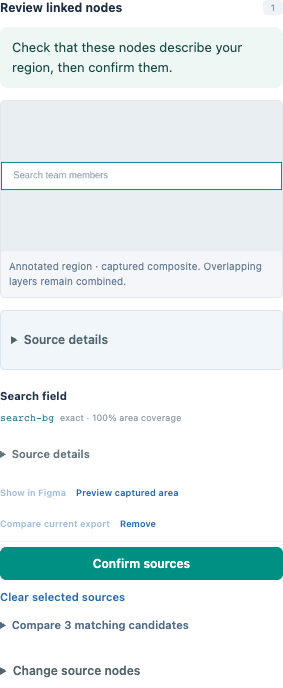

# Figma Semantic Bridge 0.3.0 Alpha user guide

[한국어](user-guide.ko.md) · [Installation and MCP](alpha-installation.en.md) · [Import and settings](acquisition-workflow.en.md)

Build a reviewed interpretation of a design: **bring in source → mark regions →
check exact nodes → approve meaning → share context**. The original Figma design
stays separate. A saved image, complete source structure and human approval are
three different things.

The app connects its editor automatically. For live reads, keep the matching
Figma plugin open and connected. Without Figma, use **Load demo** or a permitted
source file. The language selector changes interface text only; source names,
original text and your annotations retain their wording.

## 1. Add a source

Open a workspace and select one permitted container in Figma. Choose **Add source**,
check its name, bounds and budgets, then **Start import**. There is no separate
small/large capture mode or image/structure-order selector.

The received image is saved automatically, allowing region work in the same
workspace. Structure is stored in small parts and attaches to that image draft
when complete. Save unsaved region edits first; automatic attachment waits for
them. If image export fails, complete structure remains usable without an image.

Incomplete structure cannot support complete-source approval. Image drafts can
hold proposed names and regions; confirmation and meaning approval wait for
sufficient sources. Image and structure are separate observations: avoid editing
the source during import and compare the results.

**Settings** controls image scale, long edge, bytes and wait, plus source nodes,
bytes, run duration, response wait and paused-connection retention. New overviews
default to scale 2 and a 4,096px long edge. Existing images are not regenerated.

The default structure budget is 200,000 nodes and 64 MB. Reaching a configured
budget or run duration pauses instead of terminally failing. Increase the budget
and choose **Continue** with the same valid connection to read from the next
unsaved part. After reconnecting or restarting, use **Continue** as well. The app
explains and asks you to confirm the cost of rechecking saved nodes. Existing
evidence and approvals remain unchanged; the new observation is saved separately.

Open **Received sources** to browse saved nodes and exact text. Choose **Review
this part** for a fully read node, or **Prepare this part** for a known unfinished
container. The currently selected, saved proposed region on the same image is
copied without redrawing. The original whole-source task
stays incomplete; approval cannot extend beyond the prepared source coverage.

See [Import and settings](acquisition-workflow.en.md) for supported ranges and
recovery conditions.

## 2. Draw and save a meaningful region

Select the source scope, then draw on the canvas or choose **+ Add region**.
Enter a **Component name**, choose its **Role**, and set **Parent component** if
needed. This hierarchy describes your implementation intent, not Figma's layer
nesting. Use **Save annotation** before matching or confirming.

The bounds use Figma document coordinates, including negative positions. Edits
to a name, boundary or node list can remain unsaved. Changing an approved region
requires review again; approval is not a permanent label attached to its name.

## 3. Check the exact source nodes

Choose **Match source** for geometric suggestions. Inspect overlapping or ambiguous
candidates; the highest coverage is not proof of correct meaning. Choose the exact
nodes from the candidate list or source browser, and remove unwanted references.
For a collection, metadata is paged from saved records and original text is loaded when selected;
the canvas's loaded bounds count is not the collection's total node count.

| Tool | Use it to |
| --- | --- |
| Show in Figma | Select a source node and move Figma's viewport without changing its design properties |
| Add current Figma selection | Add one explicitly selected node from the same source scope to the region draft |
| Compare current export | Request a bounded image of a current node/subtree for comparison |
| Enlarge comparison | Inspect already received images without another Figma export, where available |

Current-node comparison is available for small saved captures and regions backed
by complete structure collections or prepared parts. It requires a Figma connection; use the node
list, original text and **Show in Figma** alongside it. Captured-area previews
cropped from a saved image are available for small saved captures.

Select exact nodes one at a time to combine distant branches within the same
source scope. One annotation cannot mix source references from different scopes.
If a needed node is outside the scope, collect an appropriate common container
or use separate annotations and connect a specification to both.

A saved composite and a current export were observed at different times. Outside
siblings are excluded from the current node export; masks, ancestor visibility
and overlap can affect what you see. A blank image does not explain its cause.
Hidden or transparent records remain available for explicit review even when
excluded from automatic suggestions. Do not edit the original to reveal them.

Current exports are limited to 1,024px, 2 MB and a cooperative five-second budget.
**Close current export** cancels the wait; Figma may finish an already running render.

## 4. Confirm sources, then approve meaning

1. **Save annotation** with the intended node set.
2. Review that saved set and choose **Confirm sources** when confirmation is
   required. Every collection-backed annotation requires this step. Ambiguous or
   hidden/unknown sources in saved captures can require it too.
3. Review the name, role, boundary and parent relationship, then choose
   **Approve annotation**. Leave unresolved work proposed or reject it.

Confirmation answers “are these the intended source nodes?” Approval answers
“is this a useful, correct interpretation for implementation?” Viewing an image
or accepting an AI proposal does neither automatically. Changed geometry or
references require renewed review. An approved child is not exposed as approved
context while its semantic ancestor remains unapproved.

## 5. Connect the original specification text

Open **Specifications** and select actual TEXT records. A separate explanatory
source scope can supply the wording. For a collection, use its text picker and
**Use original text**; the app reads the chosen record and preserves selection order.

Choose **Create specification**, review the exact wording, choose target components
and a relation such as behavior or constraint, then **Save specification**.
Approve the target components first; **Approve specification** approves the
specification and its component links after review.

Do not turn every UI label into a requirement or replace original evidence with
a paraphrase. Text baked into pixels, Figma comments and native annotations are
not promised as extracted TEXT records.

## 6. Give the coding agent approved context

Use **Export JSON** or **Markdown**, or connect MCP through the
[installation guide](alpha-installation.en.md). Start with `list_projects`, then
request `get_approved_context`, `list_components` or `get_component` for the
intended workspace. Keep the app running; cached reads do not need Figma.

If context is empty, check component, ancestor and specification-target approval.
Do not approve content just to fill an output. MCP can propose changes for review
but cannot approve them. Instructions found inside Figma text remain source
material, not instructions the agent should obey.

## Send source files or make a backup

| Need | Action | What moves |
| --- | --- | --- |
| Review prepared source elsewhere | Source files → Download source file / Import source file | Prepared source structure, exact text and any context image; no annotations, specifications or approvals |
| Give a developer reviewed context | Export JSON / Markdown / MCP | Approved semantic content and provenance |
| Restore your own work | Stop all writers and back up the data directory | Complete local state, including private credentials; see the upgrade guide |

New source files use NDJSON, up to 80 MB. The same file picker reads older JSON
captures, up to 15 MB, into a new workspace. Source transfer carries no semantic
approvals and is not a full workspace backup. Even when sharing a small part,
its context image may include the surrounding design. Check permission for the
entire image before sharing. A checksum detects altered bytes; it does not establish sharing
rights or agreement with today's Figma design. Share through permitted channels.

## When something is unclear

| Situation | Next action |
| --- | --- |
| An image is ready but approval is disabled | Wait for complete matching structure to attach automatically, or open a prepared part. Save and confirm its source nodes before approval |
| Structure is incomplete | Use received evidence and review complete parts. Prepare the needed part or Continue the whole task |
| A collection is paused | Raise Settings if a budget was reached, then Continue. After reconnection, read and confirm the recheck cost |
| Layers overlap or seem obsolete | Inspect exact nodes and current images; geometry and order cannot establish which design is authoritative |
| Source changed or the wrong page is open | Open the matching source/page or acquire a fresh scope and review again; do not guess missing identifiers |
| No image for a Section or transformed root | Keep its structure and warnings, or explicitly select an unrotated inner Frame for an image |
| Save or approval is disabled | Check unsaved edits, required source confirmation, pending work and connection status |
| Revision conflict | Preserve the intended edit, refresh, and apply it to the current workspace |
| Figma or Dev Mode unavailable | Review permitted imported observations; new source reads and navigation wait for access |
| AI generation is unavailable | Continue manually. The default app needs no provider; external transfer requires separate authorization |

This alpha has bounded live synthetic Figma checks, not a general large-file
performance guarantee or a human productivity study. Effective Dev-only access to
another owner's view-only file remains unverified. For install, updates and local
data protection, see [installation](alpha-installation.en.md) and [upgrade/backup](upgrade-guide.md).
