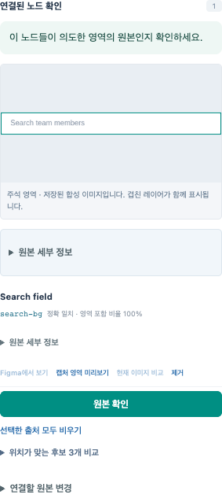

# Figma Semantic Bridge 사용 가이드

[English](user-guide.en.md) · [설치·MCP](alpha-installation.md) · [문제 해결](user-scenarios.ko.md)

**원본 추가 → 영역 저장 → 원본 확인·영역 승인 → 명세 연결 → 공유** 순서로 작업합니다.
Figma 디자인을 읽어 로컬 작업 공간에 가져오고, 사람이 검토한 설명을 코딩 에이전트에 전달합니다.

앱 편집기는 자동으로 연결됩니다. 새 원본을 가져올 때는 Figma Desktop에서 플러그인을
열어 연결하세요. 이미 저장한 자료는 Figma를 닫은 뒤에도 사용할 수 있습니다.

## 1. 원본 추가

1. 작업 공간을 만들거나 기존 작업 공간을 엽니다.
2. Figma에서 작업할 Frame 하나를 선택합니다.
3. **원본 추가**를 누르고 대상과 가져오기 한도를 확인한 뒤 **가져오기 시작**을 누릅니다.

이미지가 나타나면 영역 작업을 시작할 수 있습니다. 구조는 뒤이어 저장되고 준비되는 대로
이미지에 연결됩니다. 작성 중인 영역이 있으면 **영역 저장**을 눌러 연결을 마무리하세요.
가져오는 동안 Figma 원본을 그대로 두면 이미지와 노드를 비교하기 쉽습니다.

설정은 기본값으로 시작하세요. 더 큰 원본이 필요할 때 상단 **설정**에서 한도를 늘릴 수
있습니다. 이미지 기본값은 가로·세로 2배, 긴 변 최대 4,096px이며 구조는 20만 노드·64MB입니다.
자세한 조정 범위는 [가져오기·설정 안내](acquisition-workflow.ko.md)에 있습니다.

## 2. 영역을 그리고 저장

캔버스에 영역을 그리거나 **+ 영역 추가**를 누릅니다. **구성요소 이름**을 입력하고
**영역 저장**을 누르면 위치에 맞는 원본 노드도 함께 찾아줍니다.

처음에는 이름과 경계만 정해도 됩니다. 역할, 상위 구성요소, 정확한 좌표가 필요하면
**영역 세부 설정**을 여세요. 상위 구성요소는 구현할 화면의 관계를 나타냅니다.
Figma 레이어 구조와 동일하게 만들 필요는 없습니다.

저장한 영역을 선택하면 다시 이동하거나 크기를 바꿀 수 있습니다. 작성 중인 내용은
저장하거나 버린 뒤 다른 편집으로 넘어갑니다. 승인한 영역을 수정하면 변경된 내용을
다시 검토하게 됩니다.

## 3. 연결된 노드를 확인하고 승인

저장 후 표시되는 원본 노드가 의도한 디자인인지 확인합니다. 맞으면 **원본 확인**을
누르고, 영역의 이름과 의미를 검토한 뒤 **영역 승인**을 누릅니다.

- **원본 확인:** 이 노드들이 해당 영역의 근거인지 확인합니다.
- **영역 승인:** 이 이름·경계·역할을 구현에 사용해도 되는지 결정합니다.

노드가 겹치거나 예전 디자인이 남아 있다면 원본 검토 도구를 사용하세요.
다른 노드를 찾거나 Figma 선택을 추가하려면 **연결할 원본 변경**을 여세요.

| 하고 싶은 일 | 사용할 도구 |
| --- | --- |
| 해당 레이어를 직접 확인 | **Figma에서 보기**로 선택 위치 이동 |
| 선택한 레이어의 현재 모습 확인 | **현재 이미지 비교** |
| 자동으로 찾은 노드 수정 | 후보 목록이나 원본 검색에서 선택·제거한 뒤 **영역 저장** |
| 다른 분기의 노드를 함께 연결 | Figma에서 하나씩 선택해 **현재 Figma 선택 추가**, 이후 **영역 저장** |

이미지를 확대하거나 노드를 선택하는 것만으로 승인되지는 않습니다. 투명하거나 다른
레이어에 가려진 노드가 있다면 Figma에서 의도한 노드를 확인하세요. 서로 떨어진 노드도
같은 원본 범위 안에서는 한 영역에 연결할 수 있습니다. 범위 밖 노드까지 필요하면
공통 Frame을 가져오거나 영역을 나눠 같은 명세에 연결합니다.

상위 구성요소가 있다면 상위도 승인하세요. 공유 결과에는 승인된 상위 관계와 함께
사용할 수 있는 영역이 포함됩니다.

## 4. 명세 연결

승인한 영역에서 **명세 연결**을 누르면 해당 영역이 연결 대상으로 준비됩니다.

1. **명세 원본**에서 설명이 있는 원본을 선택합니다.
2. **원문 선택 → 원문 사용**으로 필요한 TEXT를 고릅니다.
3. **명세 만들기**를 누르고 연결할 구성요소와 관계를 확인합니다.
4. **명세 저장**, **명세 승인** 순서로 마무리합니다.

여러 원문은 선택 순서대로 보존됩니다. **연결할 구성요소 수정**에서 한 명세를 여러 구성요소에 연결할 수도 있습니다.
연결 대상부터 승인하면 명세 승인을 바로 진행할 수 있습니다.
다음 명세는 **새 명세**에서 시작하세요.

원문은 Figma TEXT 기록을 사용합니다. 이미지 안의 글자, 댓글, 네이티브 주석은 이
선택기에 나타나지 않을 수 있습니다. 요구사항이 별도 Frame에 있다면 그 Frame을 같은
작업 공간에 추가하세요.

## 5. 검토 결과 공유

**전달하기**에서 준비된 결과를 확인하고 **JSON 내보내기** 또는 **Markdown**을 선택합니다.
코딩 에이전트와 연결하려면 앱 메뉴의 **브리지 → MCP 설정 복사**를 사용하세요.
[설치·MCP 가이드](alpha-installation.md)에 연결 절차가 있습니다.

공유 결과에는 승인된 영역과 명세가 포함됩니다. 빠진 항목이 있으면 영역, 상위 구성요소,
명세 연결 대상의 승인 상태를 확인하세요. MCP를 통한 조회에도 같은 기준이 적용됩니다.
저장한 결과를 읽을 때는 앱만 켜 두면 됩니다.

## 수정과 복구

| 상황 | 다음 행동 |
| --- | --- |
| 영역을 잘못 나눴거나 삭제함 | **실행 취소**. 되돌린 편집을 다시 적용하려면 **다시 실행** |
| 이름·좌표·원본 선택을 잘못 입력함 | 초안을 수정해 **영역 저장**, 또는 변경 버리기 |
| 가져오기가 일시정지함 | **설정**에서 필요한 한도를 높이고 **계속** |
| 앱이나 플러그인을 다시 연결함 | **계속**에서 원본 재확인에 필요한 작업을 확인하고 진행 |
| 전체를 기다리지 않고 일부부터 작업하고 싶음 | **받은 원본 자료 → 이 부분 검토**. 덜 읽힌 부분은 **이 부분 준비** |
| 이미지 생성이 실패함 | 준비된 구조와 원문으로 작업하고 필요한 모습은 Figma에서 확인 |
| 작업 중 오류가 발생함 | 초안을 유지한 채 안내에 따라 수정·재시도. 반복되면 오류 시각과 진단 번호 기록 |

같은 연결에서 계속하면 받은 부분 다음부터 읽습니다. 재연결 후에는 이전에 받은 노드도
다시 확인하므로 시간이 더 걸립니다. 기존 자료와 승인은 보존됩니다.
부분 검토는 선택한 부분만 다루며 전체 가져오기의 완료 상태와는 별개입니다.

[상황별 성공·실패·복구 안내](user-scenarios.ko.md)에서 가능한 대체 경로를 확인하세요.

## 다른 기기에서 원본 검토하기

**원본 파일**의 내려받기·가져오기는 준비된 구조·원문·참고 이미지를 전달합니다.
받는 사람은 새로 영역을 만들고 검토합니다. 내 영역·명세·승인까지 복원하려면
[업데이트·백업 안내](upgrade-guide.md)에 따라 데이터 폴더를 백업하세요.

원본 파일에는 업무 자료가 들어갈 수 있습니다. 작은 부분을 내보내도 참고 이미지는 주변을
포함할 수 있으므로 공유할 파일의 전체 내용을 확인하세요. 현재 원본 파일은 최대 80MB,
이전 JSON 캡처 파일은 최대 15MB이며 이전 파일은 새 작업 공간으로 열립니다.

## 오류 기록 확인

앱의 **브리지 → 진단 로그 폴더 보기**를 열면 로컬 로그를 볼 수 있습니다.
기본 위치는 `~/.figma-semantic-bridge/logs`이며 서버·브라우저 기록은
`server.ndjson`, macOS 앱·웹뷰 기록은 `native.ndjson`에 남습니다.
오류 화면의 **오류 세부 정보**에서 진단 번호를 확인하면 관련 요청을 찾기 쉽습니다.

로그에는 작업 종류, 오류 코드, 검증 실패 위치, 처리 시간 등 진단 정보를 남깁니다.
원본 문구·이미지·연결 토큰과 콘솔에 전달한 원문은 기록 대상에서 제외합니다.
각 로그는 5MB씩 최대 5개 파일로 순환하고, 7일 지난 기록은 정리됩니다.
웹뷰를 직접 조사해야 할 때는 **브리지 → 웹 검사 활성화**를 사용할 수 있습니다.
[로컬 진단 안내](local-diagnostics.md#한국어)에서 기록 항목과 검색 예시를 확인할 수 있습니다.

## 추가 도구

**작업 공간 도구**에서 데모와 새로고침을 사용할 수 있습니다. 데모는 합성 자료입니다.
언어를 바꾸면 화면 안내만 바뀌고 원문과 작성한 이름은 유지됩니다.
AI와 에이전트가 만든 제안은 **제안 검토**에서 검토합니다. 제안을 적용한 뒤에도 사람이
각 영역과 명세를 승인합니다. 기본 수동 작업에는 모델 설정이 필요 없습니다.
외부 모델 사용은 목적지와 전송 범위를 확인하고 요청별로 동의한 경우에만 진행합니다.

이 앱은 알파 버전입니다. 원본 접근 권한과 조직의 자료 취급 규칙은 사용자가 확인해야 합니다.
실제 검증 범위와 남은 외부 조건은 [온라인 검증 기록](https://github.com/neocjmix/figma-semantic-bridge/blob/main/docs/product-validation.md)에 정리되어 있습니다.
